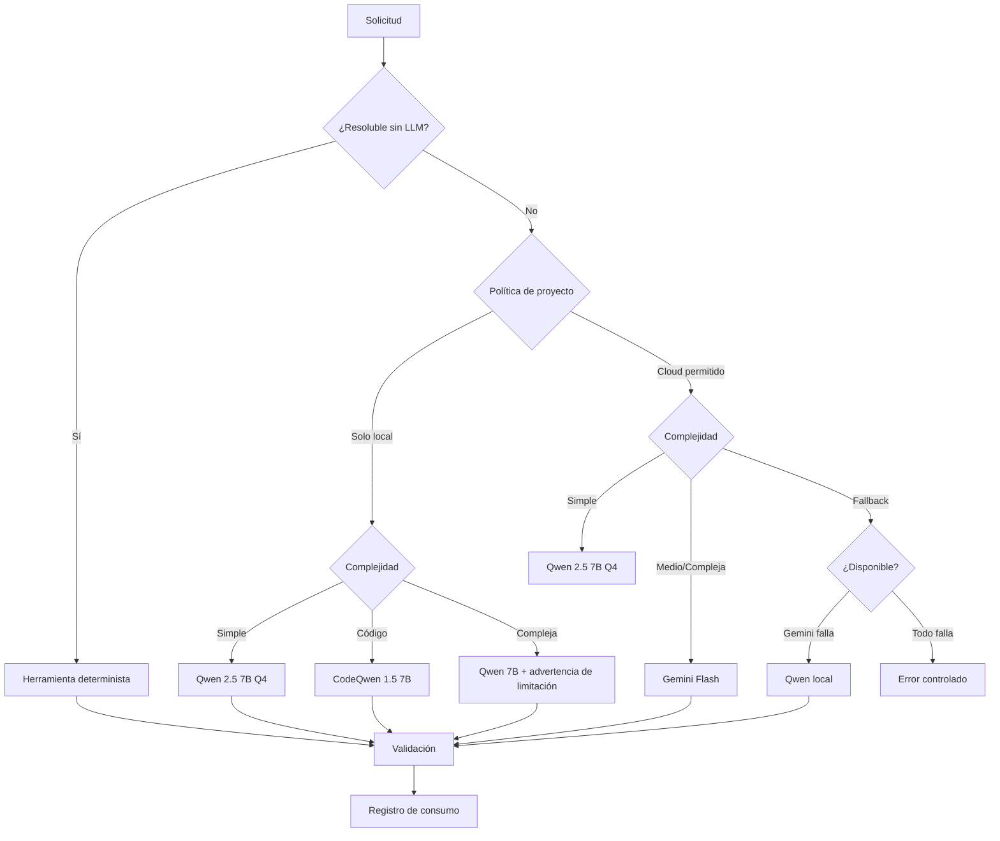

# Arquitectura de Inteligencia Artificial Híbrida — JARVIS

**v1.0 — Proveedores, selección y políticas**

Fecha: 2026-10-24

---

## 1. Principio fundamental

JARVIS es una plataforma que **utiliza** modelos de IA, no una plataforma que **depende** de uno. Debe funcionar con diferentes proveedores y sin conexión a internet (modo local).

---

## 2. Pipeline de selección



---

## 3. Proveedores soportados

### 3.1 Modelos locales (Ollama)

| Modelo | Params | Quantización | RAM estimada | Caso de uso | Limitaciones |
|--------|--------|-------------|:---:|------------|-------------|
| Qwen 2.5 7B | 7B | Q4_K_M | ~5 GB | Clasificación, resúmenes, chat simple | Razonamiento complejo limitado |
| CodeQwen 1.5 7B | 7B | Q4_K_M | ~5 GB | Análisis de código, generación de tests | No ideal para lenguaje natural |
| Qwen 2.5 3B | 3B | Q4_K_M | ~2.5 GB | Clasificación rápida, routing | Capacidad reducida |
| nomic-embed-text | - | FP16 | ~300 MB | Embeddings para RAG | Solo embeddings, no generativo |

**Restricción de hardware:** Mac mini M4 16 GB. Solo un modelo cargado en memoria a la vez. Ollama gestiona la descarga automática tras inactividad (default: 5 min).

**Selección definitiva de modelos:** La tabla anterior es una propuesta basada en compatibilidad con Apple Silicon. La selección final debe depender de benchmarks con tareas reales de JARVIS (análisis de PRs, generación de tests, clasificación de intención).

### 3.2 Proveedores cloud

| Proveedor | Modelo | Costo aprox. | Caso de uso | API key |
|-----------|--------|:---:|------------|---------|
| Gemini API | gemini-2.5-flash | Gratis (15 RPM) / ~$0.15/MTok | Razonamiento medio, tareas de volumen | `GEMINI_API_KEY` |

**Nota sobre Claude:** No se dispone de Claude API como recurso personal. La cuenta Claude Max es empresarial y compartida — no debe usarse como infraestructura de JARVIS. IAAgent tiene un provider funcional para Gemini API que JARVIS reutiliza. El provider de Claude en IAAgent se conserva como referencia pero no se activa en JARVIS.

**Nota sobre OpenAI:** GPT Plus incluye Codex para tareas de desarrollo. Si en el futuro se obtiene una API key de OpenAI, se puede agregar como provider adicional. La arquitectura es extensible.

### 3.3 Herramientas deterministas (sin LLM)

| Herramienta | Qué resuelve | Latencia |
|-------------|-------------|----------|
| DiffAnalyzer | Clasificación de archivos en un PR | <100ms |
| SecurityAnalyzer | Detección OWASP (14+ patterns) | <200ms |
| StaticAnalyzer | TODOs, debug code, secrets | <100ms |
| RiskEngine | Score de riesgo ponderado | <50ms |
| Regex + keywords | Clasificación de intención del usuario | <10ms |
| FTS5 search | Búsqueda en memoria | <50ms |

**Regla:** Si una herramienta determinista puede resolver la tarea, no se usa LLM. Los 6 analyzers de IAAgent se ejecutan ANTES del LLM.

---

## 4. Políticas por proyecto

```toml
# config/projects/integratepie.toml

[project]
id = "integratepie"
name = "IntegratePIE"

[ai_policy]
allow_cloud = true                    # Puede usar modelos cloud
allowed_providers = ["gemini", "ollama"]
default_provider = "ollama"           # Preferir local
cloud_for = ["complex_analysis", "enrichment"]  # Cloud solo para estas tareas
max_tokens_per_request = 8000
max_cost_per_day_usd = 1.00           # Presupuesto diario

[privacy]
allow_code_to_cloud = true            # Código de IntegratePIE puede ir a cloud
allow_pii_to_cloud = false            # Datos PII nunca a cloud
sensitive_patterns = ["run", "rut", "nombre_alumno", "diagnostico"]

[permissions]
read_repo = true
read_azure_devops = true
write_azure_devops = false            # Requiere aprobación manual
```

```toml
# config/projects/kamecol.toml

[project]
id = "kamecol"
name = "KameCol"

[ai_policy]
allow_cloud = true
allowed_providers = ["ollama", "gemini"]  # Claude no autorizado para datos comerciales
default_provider = "ollama"
max_cost_per_day_usd = 0.50

[privacy]
allow_code_to_cloud = true
allow_pii_to_cloud = false
sensitive_patterns = ["cedula", "telefono", "email", "direccion"]
```

---

## 5. Cadena de fallback

```python
class LLMRouter:
    def select_provider(self, task: Task, project: ProjectPolicy) -> LLMProvider:
        # 1. ¿Se puede resolver sin LLM?
        if task.is_deterministic:
            return DeterministicExecutor()

        # 2. Filtrar providers autorizados para el proyecto
        allowed = project.ai_policy.allowed_providers

        # 3. Clasificar complejidad
        complexity = self.classify_complexity(task)

        # 4. Seleccionar según complejidad
        if complexity == "simple" and "ollama" in allowed:
            return OllamaProvider(model="qwen2.5:7b-q4")

        if complexity == "code" and "ollama" in allowed:
            return OllamaProvider(model="codeqwen:7b-q4")

        if complexity in ("medium", "complex") and project.ai_policy.allow_cloud:
            # Intentar cloud con fallback
            for provider_id in self._cloud_priority(allowed):
                provider = self.get_provider(provider_id)
                if provider.is_available() and self._within_budget(project):
                    return provider

        # 5. Fallback a local siempre
        if "ollama" in allowed:
            return OllamaProvider(model="qwen2.5:7b-q4")

        raise NoProviderAvailableError(task, project)
```

**Regla de seguridad:** El fallback NUNCA elude restricciones de privacidad. Si un proyecto restringe datos a procesamiento local, el fallback es otro modelo local — nunca cloud.

---

## 6. Tracking de consumo

```sql
CREATE TABLE llm_usage (
    id TEXT PRIMARY KEY,
    timestamp TEXT NOT NULL,
    provider TEXT NOT NULL,         -- "ollama", "gemini"
    model TEXT NOT NULL,            -- "qwen2.5:7b", "gemini-2.5-flash"
    project TEXT NOT NULL,
    agent_id TEXT,
    task_type TEXT,
    input_tokens INTEGER,
    output_tokens INTEGER,
    cache_tokens INTEGER,
    cost_usd REAL,
    latency_ms INTEGER,
    success BOOLEAN,
    error TEXT
);

CREATE INDEX idx_usage_project_date ON llm_usage(project, timestamp);
```

**Dashboard de costos (CLI):**

```
$ jarvis costs --last 7d

Provider     Requests  Tokens     Cost
───────────  ────────  ─────────  ──────
ollama       142       850K       $0.00
gemini       8         32K        $0.02
───────────  ────────  ─────────  ──────
Total        150       882K       $0.02

Budget remaining: $4.98 / $5.00 (weekly)
```

---

## 7. Presupuesto configurable

```toml
# config/models.toml

[budget]
weekly_limit_usd = 5.00
daily_alert_threshold_usd = 1.50
auto_switch_to_local_at_pct = 80     # Cuando se consuma 80% del presupuesto semanal

[providers.ollama]
base_url = "http://localhost:11434"
default_model = "qwen2.5:7b-instruct-q4_K_M"
code_model = "codeqwen:1.5-7b-chat-q4_K_M"
embed_model = "nomic-embed-text"
timeout_seconds = 120

# Claude API no disponible como recurso personal.
# Si se obtiene API key de OpenAI en el futuro:
# [providers.openai]
# model = "gpt-4o-mini"
# max_tokens = 4096
# timeout_seconds = 60

[providers.gemini]
model = "gemini-2.5-flash"
max_tokens = 4096
timeout_seconds = 60
max_retries = 3
retry_delay_seconds = 2
```

---

## 8. Gestión de errores y reintentos

| Error | Acción | Fallback |
|-------|--------|----------|
| Timeout de provider | Retry 1x con timeout 2x | Siguiente provider |
| Rate limit (429) | Esperar `retry-after` header | Siguiente provider |
| API key inválida | Log + alerta | Siguiente provider |
| Modelo local no disponible | Intentar pull automático | Cloud si autorizado |
| Respuesta vacía/malformada | Retry 1x | Siguiente provider |
| Presupuesto agotado | Switch automático a local | Solo herramientas deterministas |
| Sin conexión a internet | Solo local + determinista | Informar limitación |

**Retry configurable por provider:**
- Ollama: 1 retry, 5s delay
- Gemini API: 3 retries, backoff exponencial (ya implementado en IAAgent)

---

## 9. Concurrencia

**MVP:** Todo secuencial. Un solo request LLM a la vez.

**Posterior:** 
- Requests a cloud API pueden ser async (httpx async).
- Ollama procesa una solicitud a la vez por modelo cargado.
- Huey worker puede encolar múltiples análisis, pero se procesan uno a la vez (evita contención de RAM).

---

## 10. Evaluación futura de modelos

JARVIS debe mantener un benchmark propio para evaluar modelos:

| Tarea de evaluación | Métrica | Mínimo aceptable |
|---------------------|---------|:-:|
| Clasificar intención del usuario | Accuracy | 85% |
| Generar test cases para PR real | Calidad (human eval) | 3/5 |
| Detectar vulnerabilidad en código | Recall | 70% |
| Responder consulta de catálogo KameCol | Correctitud | 90% |
| Resumir hallazgos de análisis QA | Completeness | 80% |

Los benchmarks se ejecutan con un set de 20-30 ejemplos reales, comparando modelos locales vs cloud. La decisión de usar cloud se justifica solo si la diferencia de calidad supera un umbral significativo para la tarea.
