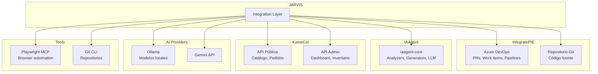
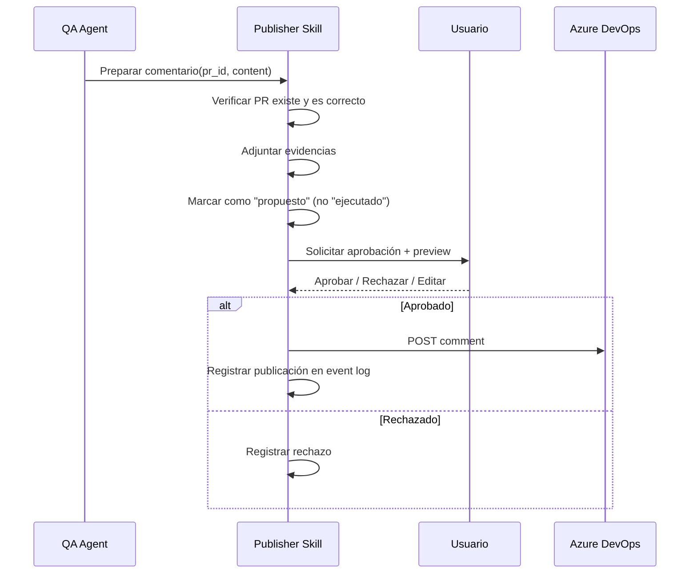

# Arquitectura de Integraciones — JARVIS

**v1.0 — Conectores, APIs y protocolos**

Fecha: 2026-10-24

---

## 1. Principio de integración

JARVIS se integra con sistemas externos como **consumidor autorizado**, no como propietario. Cada integración opera dentro de los permisos otorgados, con contratos explícitos y registro de toda actividad.

---

## 2. Mapa de integraciones



---

## 3. Azure DevOps — IntegratePIE

### 3.1 Capacidades

| Operación | Tipo | Permisos | Estado |
|-----------|------|----------|--------|
| Leer PRs (metadata, diffs, archivos) | Lectura | PAT con `Code:Read` | iaagent-core existente |
| Leer work items (PBI, bugs, tasks) | Lectura | PAT con `WorkItems:Read` | Por implementar |
| Leer pipelines y resultados | Lectura | PAT con `Build:Read` | Por implementar |
| Leer comentarios de PR | Lectura | PAT con `Code:Read` | iaagent-core existente |
| Publicar comentario en PR | Escritura | PAT con `Code:Write` + aprobación | iaagent-core existente (gated) |
| Actualizar work items | Escritura | PAT con `WorkItems:Write` + aprobación | Fase posterior |

### 3.2 Cliente existente (iaagent-core)

IAAgent tiene un cliente Azure DevOps maduro (`azure_devops.py`, 1,018 líneas) que soporta:
- Listar PRs por estado y repositorio.
- Obtener detalles de PR (metadata, reviewers).
- Obtener diffs y archivos del branch target.
- Publicar comentarios (con feature flag `AZDO_ENABLE_PUBLISH`).
- Multi-repositorio.

**Reutilización:** Directa. JARVIS importa este cliente de iaagent-core.

### 3.3 Extensiones necesarias

| Extensión | Justificación | Prioridad |
|-----------|--------------|-----------|
| Lectura de work items | Interpretar requerimientos para QA | P1 |
| Lectura de adjuntos de work items | Analizar specs y mockups | P2 |
| Lectura de criterios de aceptación | Generar test cases alineados | P1 |
| Consulta de pipelines | Verificar estado de CI/CD | P2 |

### 3.4 Flujo de publicación controlada



---

## 4. KameCol — APIs

### 4.1 Cliente API público (sin autenticación)

```python
class KameColPublicClient:
    """Cliente para APIs públicas de KameCol."""

    def __init__(self, base_url: str):
        self.base_url = base_url

    def get_products(self, search: str = None, category: str = None) -> list[Product]:
        """GET /api/products/ — Catálogo con filtros."""

    def get_product_detail(self, slug: str) -> ProductDetail:
        """GET /api/products/{slug}/ — Detalle con variantes y stock."""

    def get_navigation(self) -> NavigationTree:
        """GET /api/navigation/ — Árbol de categorías."""

    def get_transaction_status(self, reference: str) -> TransactionStatus:
        """GET /api/transaction-status/{ref}/ — Estado de pedido."""
```

### 4.2 Cliente API admin (requiere credenciales)

**Prerequisito:** KameCol necesita implementar API key auth para acceso server-to-server. Actualmente solo soporta sesión Django + 2FA.

```python
class KameColAdminClient:
    """Cliente para APIs admin de KameCol. Requiere API key."""

    def get_pending_orders(self) -> list[Order]:
        """GET /api/admin/orders/pending-recovery/"""

    def send_reminder(self, reference: str) -> bool:
        """POST /api/admin/orders/{ref}/send-reminder/"""

    def get_dashboard_kpis(self, period: str) -> DashboardKPIs:
        """GET /api/admin/dashboard/kpis/?period={period}"""

    def get_analytics(self, date_from: str, date_to: str) -> AnalyticsData:
        """GET /api/admin/analytics/"""

    def get_inventory_pools(self) -> list[InventoryPool]:
        """GET /api/admin/inventory/pools/"""
```

### 4.3 Cambios necesarios en KameCol

| Cambio | Esfuerzo | Prioridad |
|--------|----------|-----------|
| Implementar API key auth para endpoints admin | ~2h | P1 (antes de integrar) |
| Configurar CORS para dominio de JARVIS | ~30min | P1 |
| Endpoint de validación `(cedula + reference)` para self-service | ~1h | P2 |
| Configurar HSTS | ~15min | P1 |

---

## 5. IAAgent como módulo

### 5.1 Interfaz de integración

```python
# JARVIS importa iaagent-core como paquete
from iaagent_core.analyzers import DiffAnalyzer, SecurityAnalyzer, RiskEngine
from iaagent_core.generators import TestCaseGenerator, ReportGenerator
from iaagent_core.llm import LLMProvider, LLMFactory
from iaagent_core.models import PRContext, QAReport
from iaagent_core.integrations import AzureDevOpsClient

# El QA Agent de JARVIS orquesta los componentes de iaagent-core
class JarvisQAAgent:
    def __init__(self, iaagent_analyzers, iaagent_generators, llm_router):
        self.analyzers = iaagent_analyzers
        self.generators = iaagent_generators
        self.llm = llm_router

    def analyze_pr(self, pr_id: int, project: str) -> QAReport:
        # 1. Fetch PR data (iaagent-core)
        # 2. Run deterministic analyzers (iaagent-core)
        # 3. Inject memory context (JARVIS)
        # 4. LLM enrichment (JARVIS LLM Router)
        # 5. Generate report (iaagent-core)
        # 6. Store in memory (JARVIS)
        # 7. Return with evidence (JARVIS)
        ...
```

---

## 6. Playwright MCP

### 6.1 Configuración

```json
{
    "mcpServers": {
        "playwright": {
            "command": "npx",
            "args": ["@playwright/mcp", "--headless"],
            "env": {}
        }
    }
}
```

### 6.2 Uso por el QA Agent

Playwright MCP se usa para:
1. **Ejecutar tests E2E** contra IntegratePIE (entorno de QA).
2. **Capturar evidencias** (screenshots, PDFs).
3. **Verificar estados de UI** después de acciones.
4. **Validar accesibilidad**.

**Control de recursos:** El browser se inicia solo cuando se necesita y se cierra después. En Mac mini 16 GB, un browser headless consume ~200-400 MB.

---

## 7. WhatsApp Business API (futuro)

### 7.1 Prerequisitos

| Requisito | Estado | Costo |
|-----------|--------|-------|
| WhatsApp Business Account | No creado | Gratis |
| Meta Business verification | No iniciado | Gratis |
| WhatsApp Cloud API access | No configurado | ~$0.05-0.08 por conversación |
| Webhook server (JARVIS API) | FastAPI disponible | Infraestructura existente |
| Número de teléfono dedicado | No asignado | Costo del plan |

### 7.2 Flujo propuesto

```
Cliente (WhatsApp) → Meta Cloud API → Webhook → JARVIS API
  → Customer Support Agent
    → KameCol Public API (catálogo, pedidos)
    → LLM (respuesta conversacional)
  → Meta Cloud API → Cliente (WhatsApp)
```

**Prioridad:** P3. Requiere inversión externa (WhatsApp Business API) y no es parte del MVP.

---

## 8. Registro de herramientas (Tool Registry)

Cada integración se registra como herramienta en JARVIS:

```python
@dataclass
class ToolRegistration:
    id: str                          # "azdo.read_pr", "kamecol.get_products"
    name: str
    description: str
    integration: str                 # "azure_devops", "kamecol", "playwright"
    operation_type: str              # "read", "write", "execute"
    requires_approval: bool
    allowed_projects: list[str]
    parameters: dict                 # JSON Schema
    returns: dict                    # JSON Schema
    rate_limit: str | None           # "10/min", "5/hour"
    timeout_seconds: int
```

**Ejemplo de registro:**

```python
tools = [
    ToolRegistration(
        id="azdo.read_pr",
        name="Leer Pull Request",
        description="Obtiene metadata, diffs y archivos de un PR de Azure DevOps",
        integration="azure_devops",
        operation_type="read",
        requires_approval=False,
        allowed_projects=["integratepie"],
        parameters={"pr_id": "integer", "include_diffs": "boolean"},
        returns={"pr_context": "PRContext"},
        rate_limit="30/min",
        timeout_seconds=30
    ),
    ToolRegistration(
        id="azdo.publish_comment",
        name="Publicar comentario en PR",
        description="Publica un comentario de análisis QA en un PR",
        integration="azure_devops",
        operation_type="write",
        requires_approval=True,    # Siempre requiere aprobación
        allowed_projects=["integratepie"],
        parameters={"pr_id": "integer", "content": "string", "evidence": "list"},
        returns={"comment_id": "integer", "url": "string"},
        rate_limit="5/hour",
        timeout_seconds=30
    ),
]
```

---

## 9. Gestión de credenciales

| Integración | Tipo de credencial | Storage | Rotación |
|------------|-------------------|---------|----------|
| Azure DevOps | Personal Access Token (PAT) | `.env` / env var | Manual (90 días) |
| Gemini API | API Key | `.env` / env var | Manual |
| KameCol Admin | API Key (por crear) | `.env` / env var | Manual |
| WhatsApp | Access Token + App Secret | `.env` / env var | Automática (Meta) |

**Reglas:**
- Credenciales NUNCA en el repositorio.
- `.env` está en `.gitignore`.
- `.env.example` documenta las variables necesarias sin valores.
- Los logs nunca contienen credenciales (sanitizer de IAAgent aplicado globalmente).
- Cada proyecto tiene sus propias credenciales; no se comparten.
