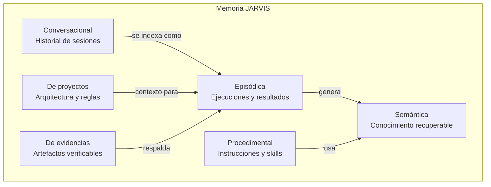
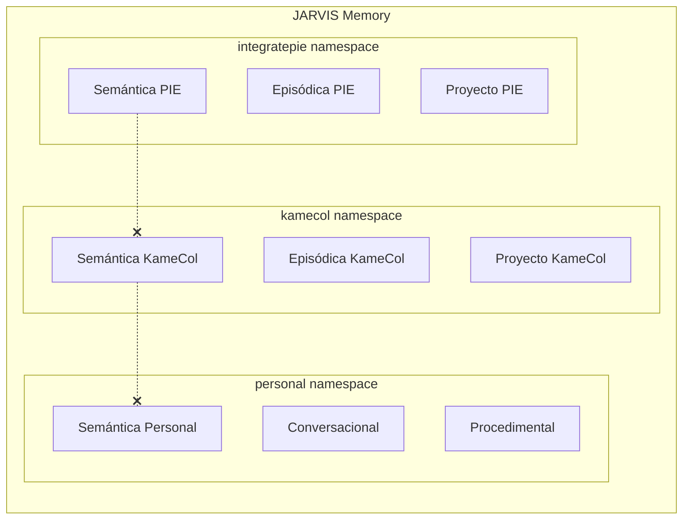
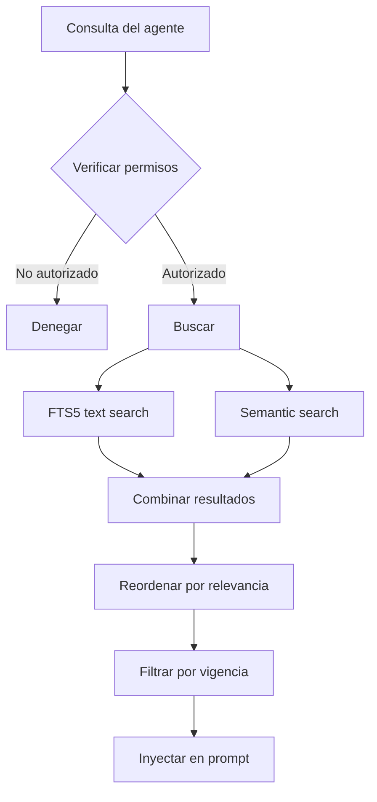

# Arquitectura de Memoria Persistente — JARVIS

**v1.0 — Diseño del sistema de memoria y RAG**

Fecha: 2026-10-24

---

## 1. Objetivo estratégico

El principal diferenciador de JARVIS frente a un LLM genérico es la **memoria persistente**. El usuario no debería repetir información sobre sus proyectos entre sesiones. JARVIS debe recordar:

- Análisis previos y sus resultados.
- Arquitectura y reglas de negocio de cada proyecto.
- Decisiones tomadas y su justificación.
- Procedimientos y workflows validados.
- Evidencias de ejecuciones anteriores.

---

## 2. Tipos de memoria



### 2.1 Memoria conversacional

| Aspecto | Detalle |
|---------|---------|
| **Qué almacena** | Historial de interacciones por sesión |
| **Formato** | Mensajes con rol (user/assistant/system), timestamps |
| **Retención** | Últimas N sesiones completas + resúmenes de sesiones antiguas |
| **Recuperación** | Por fecha, por proyecto, por búsqueda de texto |
| **Storage** | SQLite tabla `conversations` |

### 2.2 Memoria episódica

| Aspecto | Detalle |
|---------|---------|
| **Qué almacena** | Ejecuciones de agentes y sus resultados |
| **Formato** | Event stream + resultados estructurados |
| **Ejemplo** | "El 2026-10-20, el QA Agent analizó PR #1234 de IntegratePIE. Risk score: 7/10. Encontró 3 vulnerabilidades de seguridad." |
| **Retención** | Indefinida |
| **Recuperación** | Por proyecto, por agente, por fecha, por tipo de resultado |
| **Storage** | SQLite tabla `episodes` + archivos de evidencia |

### 2.3 Memoria semántica

| Aspecto | Detalle |
|---------|---------|
| **Qué almacena** | Conocimiento verificado y recuperable por significado |
| **Formato** | Documentos indexados con embeddings |
| **Ejemplo** | "IntegratePIE: el Decreto 170/2009 define 33 categorías de NEE. GArc (ID 33) se evalúa con FUR tipo TEA desde 2026." |
| **Retención** | Hasta invalidación por Knowledge Auditor |
| **Recuperación** | Búsqueda semántica (embeddings) + filtro por proyecto |
| **Storage** | SQLite + archivos (MVP) → PostgreSQL + pgvector (posterior) |

### 2.4 Memoria procedimental

| Aspecto | Detalle |
|---------|---------|
| **Qué almacena** | Procedimientos, instrucciones y skills validados |
| **Formato** | Templates de prompts + secuencias de steps |
| **Ejemplo** | "Para analizar un PR de IntegratePIE: 1) Verificar si toca config/fur.php, 2) Si sí, ejecutar SecurityAnalyzer con umbral alto..." |
| **Retención** | Versionada |
| **Recuperación** | Por tipo de tarea, por proyecto |
| **Storage** | Archivos TOML/Markdown en `config/prompts/` |

### 2.5 Memoria de proyectos

| Aspecto | Detalle |
|---------|---------|
| **Qué almacena** | Arquitectura, componentes, reglas de negocio, decisiones |
| **Formato** | Documentos estructurados con metadatos |
| **Ejemplo** | "IntegratePIE: 78 controladores, 46 servicios, cadena FUDEI→FUR→PAI→PACI, 67 tipos de formularios" |
| **Retención** | Hasta actualización |
| **Recuperación** | Por proyecto + tipo de información |
| **Storage** | SQLite tabla `project_knowledge` + archivos markdown |

### 2.6 Memoria de evidencias

| Aspecto | Detalle |
|---------|---------|
| **Qué almacena** | Artefactos verificables de ejecuciones |
| **Formato** | Screenshots, logs, reportes, traces, respuestas de API |
| **Retención** | Configurable por proyecto (default: 90 días) |
| **Recuperación** | Por episode_id, por tipo, por fecha |
| **Storage** | Filesystem `data/evidence/{project}/{date}/{job_id}/` |

---

## 3. Modelo de datos

### 3.1 Esquema de un registro de memoria

```python
@dataclass
class MemoryRecord:
    id: str                          # UUID
    project: str                     # "integratepie", "kamecol", "personal"
    memory_type: MemoryType          # conversational, episodic, semantic, procedural, project, evidence
    source: str                      # Origen: "agent:qa.analyzer", "user", "document:fur.php"
    source_url: str | None           # URL o path del origen
    content: str                     # Contenido textual
    embedding: list[float] | None    # Vector de embedding (cuando aplique)
    metadata: dict                   # Metadatos adicionales
    confidence: float                # 0.0 - 1.0
    status: str                      # "active", "stale", "archived", "invalidated"
    created_at: datetime
    updated_at: datetime
    expires_at: datetime | None
    version: int
    parent_id: str | None            # Para relaciones jerárquicas
    tags: list[str]
    permissions: list[str]           # Qué proyectos pueden acceder
```

### 3.2 Schema SQLite (MVP)

```sql
CREATE TABLE memory (
    id TEXT PRIMARY KEY,
    project TEXT NOT NULL,
    memory_type TEXT NOT NULL,
    source TEXT NOT NULL,
    source_url TEXT,
    content TEXT NOT NULL,
    metadata TEXT,              -- JSON
    confidence REAL DEFAULT 1.0,
    status TEXT DEFAULT 'active',
    created_at TEXT NOT NULL,
    updated_at TEXT NOT NULL,
    expires_at TEXT,
    version INTEGER DEFAULT 1,
    parent_id TEXT,
    tags TEXT,                  -- JSON array
    permissions TEXT            -- JSON array
);

CREATE INDEX idx_memory_project ON memory(project);
CREATE INDEX idx_memory_type ON memory(memory_type);
CREATE INDEX idx_memory_status ON memory(status);
CREATE INDEX idx_memory_created ON memory(created_at);

-- FTS5 para búsqueda de texto completo (MVP, sin embeddings)
CREATE VIRTUAL TABLE memory_fts USING fts5(
    content,
    content='memory',
    content_rowid='rowid'
);

CREATE TABLE episodes (
    id TEXT PRIMARY KEY,
    project TEXT NOT NULL,
    agent_id TEXT NOT NULL,
    task_type TEXT NOT NULL,
    status TEXT NOT NULL,
    input_summary TEXT,
    output_summary TEXT,
    evidence_path TEXT,
    duration_ms INTEGER,
    tokens_used INTEGER,
    cost_usd REAL,
    created_at TEXT NOT NULL,
    metadata TEXT               -- JSON
);

CREATE TABLE events (
    id TEXT PRIMARY KEY,
    timestamp TEXT NOT NULL,
    event_type TEXT NOT NULL,
    agent_id TEXT,
    project TEXT,
    payload TEXT NOT NULL,      -- JSON
    parent_event_id TEXT
);
```

---

## 4. Aislamiento de memoria por proyecto



**Reglas de aislamiento:**

1. **Cada consulta de memoria incluye filtro de proyecto.** Un agente de KameCol no puede acceder a memoria de IntegratePIE.
2. **El namespace "personal"** contiene conocimiento compartido (procedimientos generales, preferencias del usuario).
3. **Componentes compartidos** (LLM, logging) están en namespace "system" — no contienen datos de negocio.
4. **Cross-project queries** requieren autorización explícita y se registran en el event log.
5. **Datos sensibles** (RUT, cédula, diagnósticos NEE) nunca se almacenan en la memoria semántica de JARVIS. Solo se almacenan referencias ("PR #1234 contiene cambios en datos de estudiantes").

---

## 5. Estrategia RAG (Retrieval-Augmented Generation)

### 5.1 Pipeline de incorporación


**Paso 1 — Autorización:** Solo se incorporan documentos explícitamente autorizados por el usuario. No se indexan automáticamente archivos del filesystem.

**Paso 2 — Parsing:** Extraer texto de Markdown, código fuente, JSON, TOML. No se soportan PDFs ni Word en el MVP.

**Paso 3 — Chunking:**

| Tipo de documento | Estrategia de chunking | Tamaño |
|-------------------|----------------------|--------|
| Código fuente | Por función/clase | Variable |
| Markdown | Por sección (headers) | 500-1500 tokens |
| Configuración | Por bloque lógico | Variable |
| Reportes QA | Por sección | 500-1000 tokens |

**Paso 4 — Embeddings (MVP):**

| Opción | Modelo | Dimensión | Ubicación | Costo |
|--------|--------|-----------|-----------|-------|
| **MVP** | `nomic-embed-text` vía Ollama | 768 | Local | Gratis |
| **Posterior** | OpenAI `text-embedding-3-small` | 1536 | Cloud | ~$0.02/1M tokens |

**Paso 5 — Indexación:**
- MVP: SQLite + búsqueda FTS5 (texto completo) + cosine similarity manual.
- Posterior: PostgreSQL + pgvector con índice HNSW.

**Paso 6 — Almacenamiento:** Cada chunk se almacena con:
- Referencia al documento original.
- Proyecto asociado.
- Fecha de incorporación.
- Nivel de confianza.
- Permisos de acceso.

### 5.2 Pipeline de recuperación



**Búsqueda híbrida (MVP):**
1. FTS5 para búsqueda por keywords.
2. Embedding similarity para búsqueda semántica.
3. Combinar scores con peso configurable (default: 0.4 FTS + 0.6 semantic).
4. Filtrar por `status = 'active'` y `project IN (requested_projects)`.
5. Limitar a top-K resultados (default: 5).

### 5.3 Validación de fuentes

**Regla fundamental:** Las respuestas de un LLM NO se convierten automáticamente en conocimiento confiable.

| Fuente | Confianza inicial | Puede ser knowledge? |
|--------|:-:|:-:|
| Documento oficial (auditoría, spec) | 0.9 | Si |
| Código fuente verificado | 0.8 | Si |
| Resultado de herramienta determinista | 0.8 | Si |
| Análisis QA con evidencia | 0.7 | Si, con revisión |
| Respuesta LLM validada por humano | 0.6 | Si |
| Respuesta LLM sin validación | 0.3 | **No** |
| Input de usuario sin verificar | 0.5 | Con flag |

---

## 6. Curaduría de conocimiento

### 6.1 Knowledge Curator (proceso periódico)

Funciones:
1. Identificar información nueva de episodios recientes que vale la pena persistir.
2. Proponer actualizaciones a conocimiento existente.
3. Detectar información contradictoria.
4. Consolidar múltiples episodios en un resumen semántico.

### 6.2 Knowledge Auditor (skill periódico)

Funciones:
1. Verificar que la fuente original sigue siendo válida (ej: el archivo de código aún existe).
2. Marcar como "stale" conocimiento con más de N días sin verificación.
3. Detectar duplicados.
4. Reportar inconsistencias.

### 6.3 Correcciones humanas

El usuario puede:
- Confirmar conocimiento propuesto → confidence += 0.1.
- Corregir conocimiento incorrecto → actualizar contenido, mantener historial.
- Invalidar conocimiento → status = "invalidated", mantener para auditoría.
- Agregar conocimiento manualmente → fuente = "user", confidence = 0.7.

---

## 7. Escalabilidad

### Fase MVP — SQLite + FTS5

```
data/
├── jarvis.db         # Tabla memory + FTS5
├── jarvis-jobs.db    # Huey
└── evidence/         # Archivos
```

- Soporta ~100K registros de memoria sin problemas.
- FTS5 proporciona búsqueda de texto completo eficiente.
- Embeddings almacenados como BLOB en SQLite (cosine similarity en Python).
- **Trigger de migración:** Cuando el tiempo de búsqueda semántica supere 500ms o el volumen supere 50K chunks con embedding.

### Fase posterior — PostgreSQL + pgvector

```sql
CREATE EXTENSION vector;

ALTER TABLE memory ADD COLUMN embedding vector(768);
CREATE INDEX idx_memory_embedding ON memory
    USING hnsw (embedding vector_cosine_ops);
```

- pgvector con índice HNSW: búsqueda sub-10ms en 100K+ vectores.
- PostgreSQL permite queries complejas combinando filtros SQL + similarity.
- Misma API de Memory Manager, solo cambia el store backend.

---

## 8. Métricas de memoria

| Métrica | Descripción | Target |
|---------|-------------|--------|
| Retrieval relevance | % de resultados marcados como útiles por el agente/usuario | >70% |
| Memory staleness | % de registros no verificados en >30 días | <20% |
| Cross-project leakage | Accesos a memoria de proyecto no autorizado | 0 |
| Retrieval latency | Tiempo de búsqueda + inyección | <500ms (MVP), <100ms (pgvector) |
| Knowledge growth | Registros nuevos por semana | Monitorear tendencia |
| Duplication rate | % de registros semánticamente duplicados | <10% |
