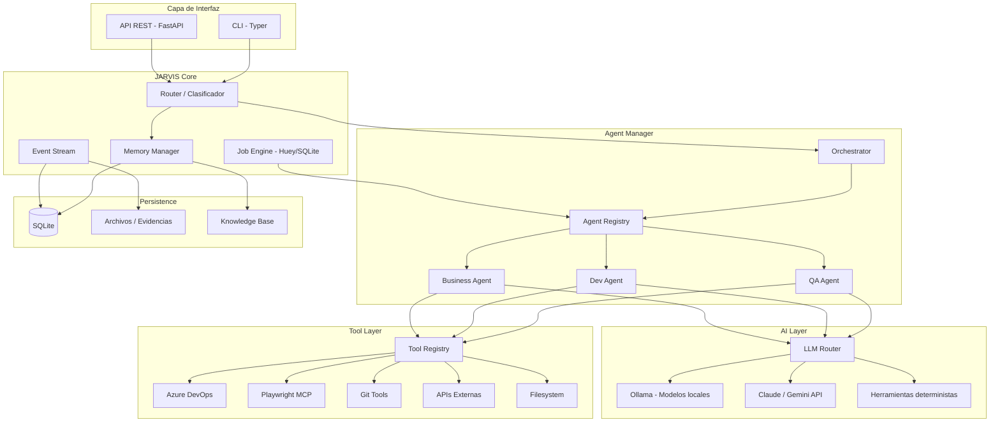
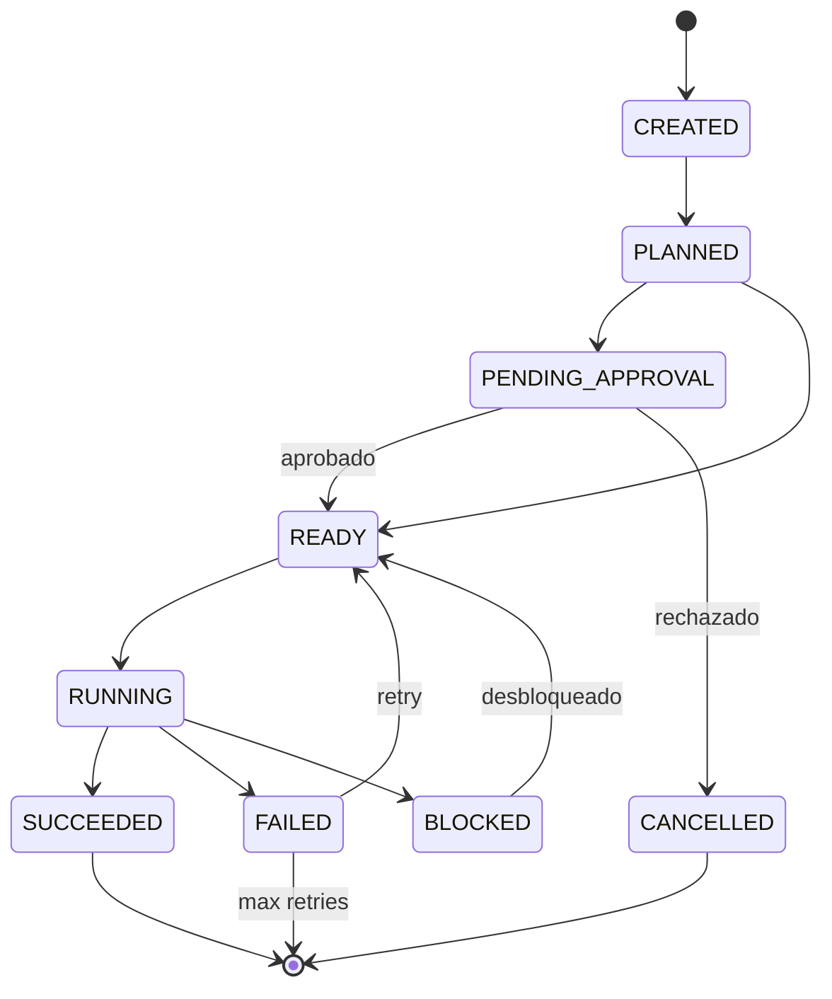
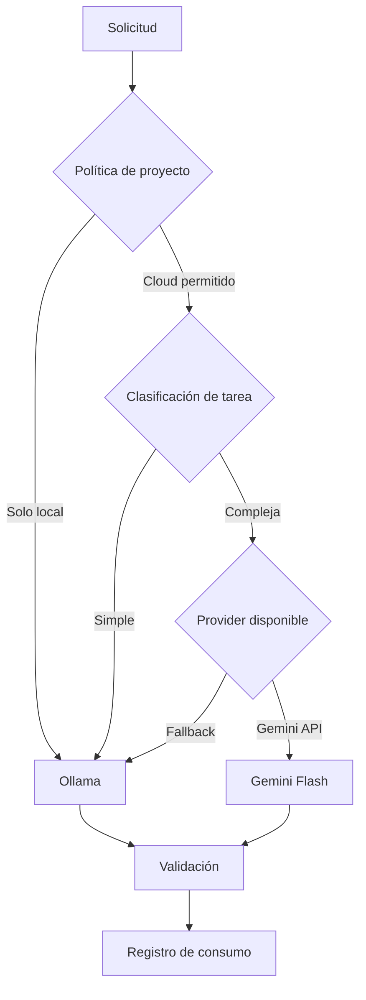
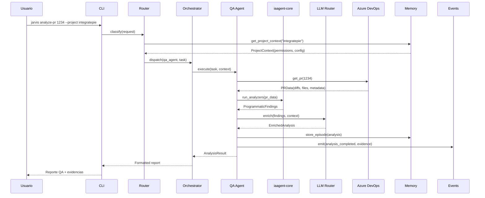
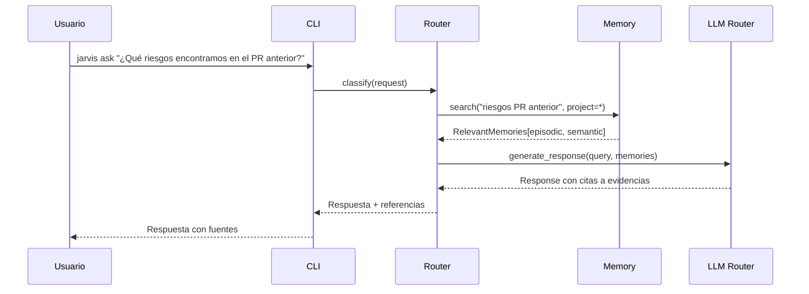

# Arquitectura del Sistema JARVIS

**v1.0 — Diseño inicial**

Fecha: 2026-10-24

---

## 1. Visión general

JARVIS es una plataforma modular de inteligencia artificial híbrida que coordina agentes especializados para automatizar tareas de QA, desarrollo y operaciones comerciales. Opera sobre tres proyectos independientes (IntegratePIE, IAAgent, KameCol) sin convertirse en una copia de ellos.



---

## 2. Principios arquitectónicos

| # | Principio | Implicación |
|---|-----------|-------------|
| 1 | **Modularidad** | Cada componente tiene responsabilidad única y contratos definidos |
| 2 | **Independencia de proyectos** | IntegratePIE, IAAgent y KameCol mantienen sus repositorios propios |
| 3 | **IA como servicio intercambiable** | Ningún componente depende de un proveedor LLM específico |
| 4 | **Herramientas deterministas primero** | Usar LLM solo cuando el análisis programático no sea suficiente |
| 5 | **Event-driven** | Toda acción y resultado se registra como evento inmutable |
| 6 | **Seguridad por defecto** | Permisos mínimos, aislamiento de contextos, sin acceso implícito |
| 7 | **Graceful degradation** | El sistema funciona sin LLM, sin conexión a internet, sin servicios externos |
| 8 | **Evidencias verificables** | Cada ejecución genera artefactos trazables |

---

## 3. Componentes del sistema

### 3.1 Capa de interfaz

**CLI (Typer)**

Punto de entrada principal para la primera versión. Comandos esperados:

```
jarvis ask "¿Cuáles son los riesgos del PR 1234?"
jarvis analyze-pr 1234 --project integratepie
jarvis status
jarvis jobs list
jarvis memory search "reglas FUR 2026"
```

**API REST (FastAPI)**

Servidor HTTP para integración programática y futura interfaz web.

```
POST /api/v1/ask
POST /api/v1/jobs
GET  /api/v1/jobs/{id}
GET  /api/v1/jobs/{id}/evidence
GET  /api/v1/memory/search?q=...
GET  /api/v1/agents
GET  /api/v1/health
```

### 3.2 JARVIS Core

**Router / Clasificador**

Recibe solicitudes y determina:
1. Si requiere un agente o una herramienta directa.
2. Qué proyecto está involucrado (→ políticas de acceso).
3. Si requiere LLM o es resoluble determinísticamente.
4. Nivel de autonomía requerido.

El router puede ser determinista (regex + keywords) para casos simples, o usar un LLM ligero local para clasificación de intención.

**Memory Manager**

Gestiona todos los tipos de memoria (ver MEMORY-ARCHITECTURE.md):
- Búsqueda por relevancia semántica.
- Recuperación de contexto de proyecto.
- Inyección de conocimiento al prompt del agente.

**Job Engine (Huey/SQLite)**

Motor de trabajos asincrónicos:

```python
from huey import SqliteHuey

huey = SqliteHuey(filename='data/jarvis-jobs.db')

@huey.task(retries=2, retry_delay=30)
def execute_agent_task(task_id: str):
    ...

@huey.periodic_task(crontab(hour='9', minute='0'))
def daily_maintenance():
    ...
```

Estados de un job:



**Event Stream**

Registro inmutable de toda la actividad del sistema. Patrón inspirado en OpenHands:

```python
@dataclass(frozen=True)
class Event:
    id: str
    timestamp: datetime
    event_type: str          # "action", "observation", "system"
    agent_id: str | None
    project: str | None
    payload: dict
    parent_event_id: str | None
```

Todos los eventos se persisten en SQLite y se usan para:
- Trazabilidad y auditoría.
- Replay y debugging.
- Alimentar memoria episódica.
- Métricas de observabilidad.

### 3.3 Agent Manager

**Registry**

Registro dinámico de agentes disponibles:

```python
@dataclass
class AgentSpec:
    id: str
    name: str
    description: str
    skills: list[str]
    tools: list[str]
    required_permissions: list[str]
    supported_projects: list[str]
    llm_preference: str       # "local", "cloud", "any"
    autonomy_level: int       # 0-4
```

**Orchestrator**

Coordina la ejecución de agentes:
1. Recibe la solicitud clasificada del Router.
2. Selecciona el agente apropiado.
3. Inyecta contexto de memoria.
4. Ejecuta (síncrono o vía Huey).
5. Valida resultados.
6. Registra eventos y evidencias.

Para tareas complejas, el Orchestrator puede:
- Dividir en subtareas.
- Coordinar múltiples agentes secuencialmente.
- Solicitar aprobación humana antes de acciones con efectos externos.

### 3.4 Tool Layer

**Tool Registry**

Cada herramienta declara su contrato siguiendo el patrón Action/Observation:

```python
@dataclass(frozen=True)
class ToolAction:
    """Input tipado para una herramienta."""
    tool_id: str
    parameters: dict

@dataclass(frozen=True)
class ToolObservation:
    """Output tipado de una herramienta."""
    tool_id: str
    success: bool
    result: dict
    evidence: list[Evidence]
    duration_ms: int

class Tool(Protocol):
    id: str
    name: str
    description: str
    permissions: list[str]
    has_side_effects: bool

    def execute(self, action: ToolAction, context: ProjectContext) -> ToolObservation:
        ...
```

**Clasificación de herramientas:**

| Tipo | Efecto | Aprobación | Ejemplos |
|------|--------|-----------|----------|
| **Informativa** | Solo lectura | No requerida | Leer PR, buscar en memoria, consultar catálogo |
| **Analítica** | Genera resultado | No requerida | Analizar diff, calcular riesgo, generar test cases |
| **Propositiva** | Prepara acción | No requerida | Preparar comentario, generar reporte |
| **Ejecutiva** | Modifica estado | **Nivel 2+** | Publicar en Azure DevOps, enviar email |
| **Destructiva** | Elimina/altera | **Siempre** | Borrar archivo, modificar configuración |

### 3.5 AI Layer

**LLM Router**

Selecciona el proveedor apropiado según políticas del proyecto:



**Proveedores soportados (MVP):**

| Proveedor | Tipo | Uso principal | Costo |
|-----------|------|---------------|-------|
| Ollama (Qwen 2.5 7B Q4) | Local | Clasificación, resúmenes, tareas simples | Gratis |
| Ollama (CodeQwen 1.5 7B) | Local | Análisis de código, generación de tests | Gratis |
| Gemini API (Flash) | Cloud | Razonamiento medio, tareas de volumen | Gratis con límites / por token |

**Herramientas deterministas (sin LLM):**

Los 6 analyzers de IAAgent son completamente deterministas:
- DiffAnalyzer: clasificación de archivos por regex.
- StaticAnalyzer: detección de patterns (TODOs, debug code, secrets).
- SecurityAnalyzer: 14+ patrones OWASP.
- DependencyAnalyzer: cambios en manifests.
- ImpactAnalyzer: clasificación de áreas impactadas.
- RiskEngine: score ponderado 0-10.

Estos se ejecutan ANTES de cualquier llamada LLM, reduciendo costos y latencia.

---

## 4. Stack tecnológico definitivo

| Componente | Tecnología | Justificación |
|-----------|-----------|---------------|
| **Lenguaje** | Python 3.12+ | Compatible con IAAgent, ecosistema AI maduro |
| **API** | FastAPI | Async, tipado, OpenAPI automático, ligero |
| **CLI** | Typer | Misma librería que IAAgent, tipado |
| **Jobs** | Huey + SqliteHuey | Zero dependencias, MIT, ideal para hardware personal |
| **DB** | SQLite (MVP) → PostgreSQL + pgvector (posterior) | Simplicidad inicial, migración justificada por volumen |
| **IA local** | Ollama | Gestión simplificada de modelos locales en Apple Silicon |
| **IA cloud** | Gemini API (proveedor extensible) | Reutiliza provider de IAAgent. Claude API no disponible como recurso personal |
| **Modelos** | Pydantic v2 | Validación de contratos, serialización JSON |
| **QA automation** | Playwright MCP | Estándar MCP para browser automation |
| **Tests** | pytest | Misma herramienta que IAAgent |
| **Logs** | Rich | Misma librería que IAAgent, output enriquecido |
| **Config** | TOML + env vars | Prompts en config (patrón PR-Agent), secretos en env |
| **Serialización** | JSON | Eventos, evidencias, comunicación inter-agente |

**Tecnologías descartadas:**

| Tecnología | Razón |
|-----------|-------|
| LangGraph / LangChain | Dependencia pesada, modelo mental rígido |
| CrewAI | Routing por LLM, no determinista |
| AutoGen | En declive |
| n8n | Excesivo para el core; posible complemento posterior |
| Celery + Redis | Overhead innecesario para uso personal |
| MongoDB | Sin justificación frente a SQLite/PostgreSQL |
| Qdrant / Pinecone | pgvector es suficiente para el volumen esperado |

---

## 5. Estructura del repositorio

### 5.1 Estructura objetivo (completa)

```
jarvis/
├── README.md
├── pyproject.toml
├── .env.example
├── .gitignore
│
├── src/
│   └── jarvis/
│       ├── __init__.py
│       ├── __main__.py              # Entry point
│       ├── cli.py                   # CLI con Typer
│       ├── config.py                # Configuración global
│       │
│       ├── core/
│       │   ├── __init__.py
│       │   ├── router.py            # Clasificador de solicitudes
│       │   ├── orchestrator.py      # Coordinador de agentes
│       │   ├── events.py            # Event stream
│       │   └── models.py            # Modelos core (Pydantic)
│       │
│       ├── agents/
│       │   ├── __init__.py
│       │   ├── base.py              # Agent Protocol + base class
│       │   ├── registry.py          # Agent registry
│       │   ├── qa/                  # QA Agent (usa iaagent-core)
│       │   ├── dev/                 # Dev Agent
│       │   └── business/            # Business Agent
│       │
│       ├── tools/
│       │   ├── __init__.py
│       │   ├── base.py              # Tool Protocol
│       │   ├── registry.py          # Tool registry
│       │   ├── git.py               # Operaciones Git
│       │   ├── filesystem.py        # Lectura de archivos
│       │   └── mcp/                 # Conectores MCP
│       │
│       ├── llm/
│       │   ├── __init__.py
│       │   ├── base.py              # Provider Protocol (extendido de IAAgent)
│       │   ├── router.py            # LLM Router con políticas
│       │   ├── ollama.py            # Provider local
│       │   ├── openai.py            # Provider OpenAI/GPT (futuro)
│       │   ├── gemini.py            # Provider Gemini API
│       │   └── usage.py             # Tracking de consumo
│       │
│       ├── memory/
│       │   ├── __init__.py
│       │   ├── manager.py           # Memory Manager
│       │   ├── store.py             # Storage abstraction
│       │   ├── types.py             # Tipos de memoria
│       │   └── retrieval.py         # Búsqueda y recuperación
│       │
│       ├── jobs/
│       │   ├── __init__.py
│       │   ├── engine.py            # Huey instance + config
│       │   ├── tasks.py             # Task definitions
│       │   └── worker.py            # Worker entry point
│       │
│       ├── security/
│       │   ├── __init__.py
│       │   ├── context.py           # Project context + permissions
│       │   ├── policies.py          # Authorization policies
│       │   └── sanitizer.py         # Credential sanitizer (de IAAgent)
│       │
│       └── integrations/
│           ├── __init__.py
│           ├── azure_devops.py      # (de iaagent-core)
│           └── kamecol.py           # Cliente API KameCol
│
├── config/
│   ├── prompts/                     # Prompts en TOML
│   ├── projects/                    # Config por proyecto
│   └── models.toml                  # Configuración de modelos LLM
│
├── data/                            # Datos locales (gitignored)
│   ├── jarvis.db                    # SQLite principal
│   ├── jarvis-jobs.db               # Huey jobs
│   ├── evidence/                    # Evidencias de ejecuciones
│   └── knowledge/                   # Knowledge base local
│
├── tests/
│   ├── unit/
│   ├── integration/
│   └── conftest.py
│
├── docs/                            # Documentación del proyecto
│
└── scripts/
    ├── setup.sh                     # Setup inicial
    └── worker.sh                    # Iniciar worker Huey
```

### 5.2 Estructura mínima para el MVP

```
jarvis/
├── README.md
├── pyproject.toml
├── .env.example
├── .gitignore
│
├── src/jarvis/
│   ├── __init__.py
│   ├── __main__.py
│   ├── cli.py
│   ├── config.py
│   ├── core/
│   │   ├── router.py
│   │   ├── orchestrator.py
│   │   ├── events.py
│   │   └── models.py
│   ├── agents/
│   │   ├── base.py
│   │   ├── registry.py
│   │   └── qa/
│   ├── tools/
│   │   ├── base.py
│   │   └── registry.py
│   ├── llm/
│   │   ├── base.py
│   │   ├── router.py
│   │   └── ollama.py
│   ├── memory/
│   │   ├── manager.py
│   │   └── store.py
│   └── security/
│       └── context.py
│
├── config/
│   └── prompts/
│
├── data/
│
└── tests/
```

---

## 6. Flujos de ejecución principales

### 6.1 Análisis de PR (flujo QA)



### 6.2 Consulta con memoria



---

## 7. Decisiones de diseño clave

### 7.1 SQLite como base de datos inicial

**Justificación:**
- JARVIS es de uso personal (1 usuario).
- SQLite soporta ~500K+ registros sin problemas de rendimiento.
- Huey usa SQLite nativamente.
- Un solo archivo para backup.
- Migración a PostgreSQL cuando: (a) se necesite pgvector para RAG avanzado, o (b) acceso concurrente desde múltiples procesos.

### 7.2 Orquestador propio vs framework

**Justificación:**
- El orquestador de JARVIS es un loop explícito de ~200-300 líneas.
- Los frameworks (LangGraph, CrewAI) resuelven problemas de checkpointing distribuido y multi-usuario que JARVIS no tiene.
- Un orquestador propio permite control total sobre el flujo y debugging directo.

### 7.3 Pydantic v2 para todos los contratos

**Justificación:**
- IAAgent usa frozen dataclasses. JARVIS extiende a Pydantic para: validación de entrada, serialización JSON automática, documentación de schemas.
- Los contratos Action/Observation de tools y agentes son Pydantic models.
- Compatible con FastAPI (validación automática de requests/responses).

### 7.4 Event stream en SQLite (no Kafka/RabbitMQ)

**Justificación:**
- Un solo usuario, volumen bajo (~100-1000 eventos/día).
- SQLite con WAL mode soporta lectura concurrente.
- La tabla `events` es append-only (inmutable).
- Si se necesita streaming en tiempo real, agregar WebSocket sobre FastAPI.

---

## 8. Restricciones de hardware

**Mac mini M4, 16 GB RAM unificada:**

| Componente | RAM estimada | Notas |
|-----------|-------------|-------|
| macOS + sistema | ~4 GB | Base |
| JARVIS (FastAPI + worker) | ~200 MB | Python + dependencias |
| Ollama (Qwen 2.5 7B Q4) | ~5 GB | Un modelo cargado a la vez |
| Docker (si se usa) | ~1-2 GB | Playwright browser |
| SQLite | Negligible | Archivo en disco |
| **Disponible** | **~4-5 GB** | Para IDE, browser, otros procesos |

**Restricciones operativas:**
- No cargar más de un modelo Ollama simultáneamente.
- Descargar modelo cuando no se use activamente (Ollama lo gestiona automáticamente tras inactividad).
- Playwright browser se inicia solo cuando se necesita y se cierra después.
- Jobs de Huey se ejecutan secuencialmente (1 worker por defecto).

---

## 9. Evolución prevista

| Fase | Cambio arquitectónico |
|------|----------------------|
| MVP | SQLite, CLI, 1 agente QA, Ollama |
| Fase 2 | FastAPI + API REST |
| Fase 3 | PostgreSQL + pgvector, RAG |
| Fase 5 | iaagent-core como paquete |
| Fase 8 | Conectores KameCol |
| Fase 10 | Dashboard web (React/Next.js o HTMX) |
| Fase 11 | Múltiples workers, optimización de modelos |
