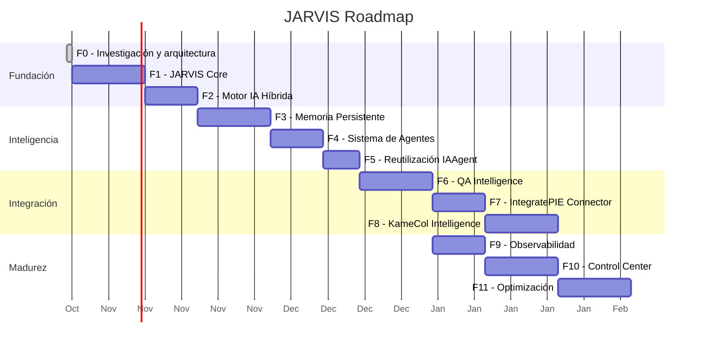

# JARVIS — Plan Maestro v1.0

**Plataforma personal de inteligencia artificial híbrida**

Fecha: 2026-10-24

---

## 1. Resumen ejecutivo

JARVIS es una plataforma modular que coordina agentes inteligentes, herramientas deterministas y modelos de IA para automatizar tareas de QA, desarrollo y operaciones comerciales sobre tres proyectos existentes: IntegratePIE, IAAgent y KameCol.

### Qué es JARVIS

Un sistema operativo de agentes con:
- **IA híbrida:** Modelos locales (Ollama) + Gemini API + herramientas deterministas.
- **Memoria persistente:** Conocimiento verificable entre sesiones.
- **Agentes especializados:** QA, desarrollo, operaciones comerciales.
- **Ejecución verificable:** Resultados con evidencias trazables.
- **Control humano:** Aprobación para operaciones con efectos externos.

### Qué NO es JARVIS

- No es un chatbot.
- No depende de un proveedor LLM específico.
- No es una copia de IntegratePIE, IAAgent o KameCol.
- No tiene acceso irrestricto a sistemas empresariales.

---

## 2. Problemas que resuelve

| Problema actual | Solución JARVIS |
|----------------|----------------|
| Repetir contexto de proyectos en cada sesión de IA | Memoria persistente por proyecto |
| QA manual y lento en PRs de IntegratePIE | Agente QA con analyzers de IAAgent |
| Funcionalidades de IAAgent sin evolución (stateless, pipeline fijo) | JARVIS como plataforma extensible que reutiliza IAAgent |
| KameCol sin atención al cliente automatizada | Agente comercial con APIs públicas |
| Dependencia de un solo proveedor de IA | Arquitectura de providers intercambiable |
| Sin trazabilidad de análisis y decisiones | Event stream + evidencias verificables |

---

## 3. Decisiones arquitectónicas fundamentales

### 3.1 Stack tecnológico

| Componente | Selección | Justificación |
|-----------|-----------|---------------|
| Lenguaje | Python 3.12+ | Compatible con IAAgent, ecosistema AI |
| API | FastAPI | Async, tipado, OpenAPI automático |
| Jobs | Huey + SqliteHuey | MIT, zero-dep, sin Redis |
| DB | SQLite (MVP) → PostgreSQL + pgvector | Simplicidad → escalabilidad justificada |
| IA local | Ollama (Qwen 2.5 7B, CodeQwen) | Apple Silicon nativo, gratis |
| IA cloud | Gemini API | Capa gratuita disponible, sin costo inicial |
| Modelos | Pydantic v2 | Validación + serialización + FastAPI |
| QA | Playwright MCP | Estándar MCP, browser automation |
| Tests | pytest | Misma herramienta que IAAgent |
| Config | TOML + env vars | Prompts en config, secretos en env |

### 3.2 Reutilización de IAAgent

**Decisión: Alternativa D — IAAgent como módulo especializado de JARVIS.**

- Se extraen ~6,400 líneas reutilizables (~64% del código productivo).
- IAAgent CLI sigue funcionando independientemente.
- JARVIS QA Agent delega análisis a `iaagent-core`.
- Ver: `docs/research/IAAGENT-REUSE-ASSESSMENT.md`, `docs/decisions/ADR-001-IAAGENT-STRATEGY.md`.

### 3.3 Frameworks descartados

| Descartado | Razón |
|-----------|-------|
| LangGraph / LangChain | Dependencia pesada, modelo rígido |
| CrewAI | Routing por LLM, no determinista |
| AutoGen | En declive |
| n8n | Excesivo para core; posible complemento posterior |
| Celery + Redis | Overhead innecesario |
| Claude API | No disponible como recurso personal |

### 3.4 Patrones adoptados

| Patrón | Origen | Aplicación |
|--------|--------|-----------|
| Action/Observation/Executor | OpenHands | Contratos tipados para tools |
| Event stream inmutable | OpenHands | Audit log y trazabilidad |
| Skills-based tool loading | Sentry MCP | Cargar solo tools relevantes |
| Configuration-driven prompts | PR-Agent | Prompts en TOML |
| Decorator-based task queue | Huey | Background jobs |
| Graceful degradation | IAAgent | Todo funciona sin LLM |

---

## 4. Infraestructura

### 4.1 Hardware

- Mac mini Apple Silicon M4, 16 GB RAM, 256 GB SSD
- Almacenamiento externo disponible

### 4.2 Software y herramientas de desarrollo

| Recurso | Tipo | Uso |
|---------|------|-----|
| Cursor | Personal | IDE con asistente AI para desarrollo |
| GPT Plus / Codex | Personal | Asistente de desarrollo, Codex para tareas |
| Mac mini + Docker | Personal/Local | Ejecución, contenedores |
| Ollama | Local | Modelos de IA locales |
| Gemini API | Gratuita/Pago | Provider cloud (capa gratis: 15 RPM) |
| Claude Max | **Empresarial (compartido)** | **No es infraestructura de JARVIS** |

### 4.3 Restricciones de presupuesto

- Priorizar open source y recursos locales.
- Gemini API capa gratuita como primer cloud provider.
- Sin suscripciones adicionales en el MVP.
- Presupuesto cloud configurable con auto-switch a local.

---

## 5. Fases de desarrollo

### Visión general

**Nota:** Los tiempos son estimaciones basadas en desarrollo asistido por IA. No son compromisos. El progreso real determinará ajustes.

### Fase 0 — Investigación y arquitectura (COMPLETADA)

- Auditorías leídas y consolidadas.
- Proyectos GitHub investigados.
- Arquitectura diseñada.
- Plan maestro documentado.
- Decisión de IAAgent tomada (Alternativa D).

### Fase 1 — JARVIS Core

**Objetivo:** Núcleo mínimo funcional — CLI + configuración + event stream + estructura base.

**Entregables:**
- Repositorio con estructura profesional y `pyproject.toml`.
- Entorno virtual Python 3.12+.
- CLI básico con Typer (`jarvis ask`, `jarvis status`).
- Sistema de configuración TOML.
- Event stream en SQLite.
- ProjectContext y SecurityGate.
- Tests con pytest.
- `.env.example` y `.gitignore`.

**Criterios de aceptación:**
- `jarvis ask "hola"` responde algo (aunque sea estático).
- Los eventos se persisten en SQLite.
- El proyecto se instala con `pip install -e .`.
- `pytest` pasa en limpio.

### Fase 2 — Motor de IA híbrida

**Objetivo:** Conectar Ollama y Gemini API con routing inteligente.

**Entregables:**
- LLM Router con clasificación de complejidad.
- Provider para Ollama (reutilizable).
- Provider para Gemini API (de IAAgent).
- Tracking de consumo (tokens, costos, latencia).
- Políticas de proyecto configurables en TOML.
- Fallback controlado.

**Criterios de aceptación:**
- `jarvis ask "explica qué es un PR"` usa modelo local.
- Gemini se usa solo cuando la política lo permite.
- Los costos se registran en SQLite.
- Sin LLM disponible, el sistema informa la limitación (no falla).

### Fase 3 — Memoria persistente

**Objetivo:** JARVIS recuerda información entre sesiones.

**Entregables:**
- Memory Manager con tipos de memoria.
- SQLite + FTS5 para búsqueda de texto.
- Embeddings locales con nomic-embed-text (Ollama).
- Namespace isolation por proyecto.
- CLI: `jarvis memory search "reglas FUR"`.

**Criterios de aceptación:**
- Almacenar un hecho y recuperarlo en una sesión posterior.
- La búsqueda semántica encuentra resultados relevantes.
- Memorias de un proyecto no aparecen en consultas de otro.

### Fase 4 — Sistema de agentes

**Objetivo:** Infraestructura para registrar y ejecutar agentes.

**Entregables:**
- Agent Protocol y base class.
- Agent Registry.
- Tool Registry con contratos Action/Observation.
- Orchestrator determinista (regex + keywords).
- Huey para background jobs.

**Criterios de aceptación:**
- Un agente de prueba se registra y ejecuta una tarea.
- El Orchestrator enruta a agentes por keywords.
- Los jobs se ejecutan en background con Huey.

### Fase 5 — Reutilización de IAAgent

**Objetivo:** Integrar componentes de IAAgent como módulo.

**Entregables:**
- `iaagent-core` empaquetado como paquete Python.
- 6 analyzers integrados como tools de JARVIS.
- 3 generators integrados.
- LLM provider de Gemini reutilizado.
- Azure DevOps client integrado.
- Tests de regresión.

**Criterios de aceptación:**
- Los analyzers de iaagent-core producen los mismos resultados dentro de JARVIS.
- IAAgent CLI sigue funcionando independientemente.
- Los tests existentes de IAAgent siguen pasando.

### Fase 6 — QA Intelligence

**Objetivo:** Agente QA funcional que analiza PRs.

**Entregables:**
- QA Agent completo con skills de análisis.
- Workflow full-pr-analysis.
- Memoria episódica de análisis anteriores.
- Generación de reportes y evidencias.
- CLI: `jarvis analyze-pr 1234 --project integratepie`.

**Criterios de aceptación:**
- Analizar un PR real de IntegratePIE y producir un reporte QA completo.
- El reporte incluye findings, test cases, risk score y escenarios Gherkin.
- La evidencia se almacena y es recuperable.
- Análisis posteriores recuperan contexto de análisis previos.

### Fase 7 — IntegratePIE Connector

**Objetivo:** Extender la integración con Azure DevOps.

**Entregables:**
- Lectura de work items (PBI, bugs).
- Extracción de criterios de aceptación.
- Knowledge base de reglas de negocio PIE.
- Publicación de comentarios con aprobación humana.

### Fase 8 — KameCol Intelligence

**Objetivo:** Capacidades comerciales para KameCol.

**Entregables:**
- Cliente API KameCol (público + admin).
- Agente de consulta de catálogo.
- Self-service de estado de pedidos.
- Recuperación automatizada de pagos.
- Resúmenes de KPIs.

### Fase 9 — Observabilidad

**Objetivo:** Métricas, evaluación y monitoreo.

**Entregables:**
- Dashboard de costos.
- Métricas de agentes.
- Benchmark de calidad.
- Health checks.

### Fase 10 — Control Center

**Objetivo:** Interfaz web para administración.

**Entregables:**
- Dashboard web (HTMX o React).
- Gestión de agentes y memoria.
- Visualización de ejecuciones y evidencias.
- Gestión de aprobaciones.

### Fase 11 — Optimización y autonomía

**Objetivo:** Mejorar rendimiento y aumentar autonomía controlada.

**Entregables:**
- Optimización de modelos locales.
- Autonomía nivel 3-4 para tareas recurrentes.
- Acceso remoto seguro (PWA).

---

## 6. MVP — Alcance mínimo viable

El MVP se completa al final de la **Fase 3** (memoria persistente), con elementos de la Fase 2 (IA híbrida).

**El MVP demuestra:**

| Capacidad | Implementación |
|-----------|---------------|
| Entrada de usuario | CLI con Typer |
| Selección de modelo | LLM Router (Ollama / Gemini) |
| Ejecución controlada | Herramientas deterministas + LLM |
| Resultado verificable | Respuesta con fuentes citadas |
| Persistencia | Memoria en SQLite + FTS5 |
| Logs | Event stream inmutable |
| Tests | pytest con cobertura base |

Ver detalle completo: `docs/planning/MVP-SCOPE.md`.

---

## 7. Riesgos principales

| Riesgo | Probabilidad | Impacto | Mitigación |
|--------|:---:|:---:|-----------|
| Modelos locales insuficientes para tareas complejas | Alta | Medio | Gemini API como fallback; priorizar herramientas deterministas |
| Complejidad excesiva antes de demostrar valor | Media | Alto | MVP pequeño, fases incrementales |
| IAAgent refactor rompe funcionalidad existente | Media | Alto | Tests de regresión antes y después |
| Costos de API se acumulan | Media | Medio | Presupuesto configurable, auto-switch a local |
| Memoria contaminada entre proyectos | Media | Alto | Namespace enforcement, tests de aislamiento |
| LLM genera información falsa como conocimiento | Alta | Medio | No auto-incorporar respuestas; confianza diferenciada |

Ver análisis completo: sección de riesgos en cada documento de arquitectura.

---

## 8. Estrategia de desarrollo

El proyecto se desarrolla con herramientas asistidas por IA:

1. **Historias pequeñas** con criterios de aceptación claros.
2. **Ramas de desarrollo** por feature.
3. **Tests antes de merge.**
4. **Documentación actualizada** con cada cambio arquitectónico.
5. **Git** como fuente de verdad compartida entre herramientas.

Las herramientas (Cursor, Codex, Claude Code) no comparten contexto automáticamente. La coordinación se logra mediante código, tests y documentación.

---

## 9. Próximo paso

**Iniciar Fase 1 — JARVIS Core:**

1. Inicializar repositorio Git.
2. Crear entorno virtual Python.
3. Configurar `pyproject.toml` con dependencias mínimas.
4. Implementar estructura de directorios del MVP.
5. CLI básico con Typer.
6. Event stream en SQLite.
7. Tests.

Primera historia: *"Como usuario, quiero ejecutar `jarvis ask 'hola'` y recibir una respuesta, para verificar que el sistema base funciona."*
