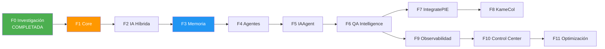

# JARVIS — Roadmap de Desarrollo

**v1.0**

Fecha: 2026-10-24

---

## Fases y dependencias



---

## Fase 0 — Investigación y arquitectura

| Campo | Valor |
|-------|-------|
| **Estado** | COMPLETADA |
| **Objetivo** | Consolidar auditorías, investigar referencias, diseñar arquitectura, planificar |
| **Entregables** | 15+ documentos de planificación y arquitectura |

---

## Fase 1 — JARVIS Core

| Campo | Valor |
|-------|-------|
| **Objetivo** | Núcleo mínimo funcional: CLI + config + events + estructura |
| **Dependencias** | F0 |
| **Complejidad** | Media |
| **Esfuerzo estimado** | 2 semanas |

**Componentes:**
1. Repositorio con `pyproject.toml` y entorno virtual.
2. CLI con Typer (`jarvis ask`, `jarvis status`, `jarvis version`).
3. Sistema de configuración TOML (`config/`).
4. Event stream en SQLite (`core/events.py`).
5. ProjectContext y SecurityGate (`security/context.py`).
6. Modelos Pydantic core (`core/models.py`).
7. Tests con pytest.
8. `.env.example`, `.gitignore`, `README.md` actualizado.

**Criterios de aceptación:**
- [ ] `pip install -e .` instala JARVIS en el venv.
- [ ] `jarvis ask "hola"` responde.
- [ ] Los eventos se persisten en SQLite.
- [ ] `pytest` pasa en limpio.
- [ ] La estructura de directorios sigue el diseño documentado.

**Riesgos:**
- Sobre-ingeniería en la estructura inicial → mantener solo lo necesario.

**Definición de terminado:** CLI funcional, eventos persistidos, tests pasando, documentación actualizada.

---

## Fase 2 — Motor de IA híbrida

| Campo | Valor |
|-------|-------|
| **Objetivo** | Conectar proveedores LLM con routing inteligente |
| **Dependencias** | F1 |
| **Complejidad** | Media |
| **Esfuerzo estimado** | 10 días |

**Componentes:**
1. LLM Provider Protocol (extendido de IAAgent `llm/base.py`).
2. OllamaProvider (`llm/ollama.py`).
3. GeminiProvider (de IAAgent `llm/gemini.py`).
4. LLM Router con clasificación de complejidad (`llm/router.py`).
5. Tracking de consumo en SQLite (`llm/usage.py`).
6. Configuración de políticas por proyecto (`config/projects/`).
7. Fallback controlado con respeto a políticas de privacidad.

**Criterios de aceptación:**
- [ ] `jarvis ask "explica qué es un PR"` usa modelo local.
- [ ] Con `GEMINI_API_KEY` configurado, tareas complejas usan Gemini.
- [ ] Sin LLM disponible, el sistema informa limitación sin fallar.
- [ ] Costos se registran en `llm_usage`.
- [ ] `jarvis costs` muestra resumen de consumo.

**Definición de terminado:** Al menos 2 providers funcionando, routing correcto, tracking de costos.

---

## Fase 3 — Memoria persistente

| Campo | Valor |
|-------|-------|
| **Objetivo** | JARVIS recuerda entre sesiones |
| **Dependencias** | F2 |
| **Complejidad** | Alta |
| **Esfuerzo estimado** | 2 semanas |

**Componentes:**
1. Memory Manager (`memory/manager.py`).
2. Memory Store con SQLite + FTS5 (`memory/store.py`).
3. Embeddings locales con nomic-embed-text via Ollama.
4. Tipos de memoria: conversacional, semántica, episódica.
5. Namespace isolation por proyecto.
6. CLI: `jarvis memory add`, `jarvis memory search`.

**Criterios de aceptación:**
- [ ] Almacenar un hecho → recuperarlo en sesión posterior.
- [ ] Búsqueda semántica encuentra resultados relevantes.
- [ ] Memorias de proyecto A no aparecen en consultas de proyecto B.
- [ ] `jarvis memory search "X"` retorna resultados con fuente y fecha.

**Hito:** Al completar F3, el MVP está funcional.

**Definición de terminado:** Memoria persistente funcional, aislamiento verificado, búsqueda híbrida operativa.

---

## Fase 4 — Sistema de agentes

| Campo | Valor |
|-------|-------|
| **Objetivo** | Infraestructura para registrar y ejecutar agentes |
| **Dependencias** | F3 |
| **Complejidad** | Media-Alta |
| **Esfuerzo estimado** | 10 días |

**Componentes:**
1. Agent Protocol y base class.
2. Agent Registry.
3. Tool Registry con contratos Action/Observation (Pydantic).
4. Orchestrator determinista (regex + keywords).
5. Huey integration para background jobs.
6. Worker process.

**Definición de terminado:** Agente de prueba se registra, ejecuta tarea vía Huey, resultado se almacena.

---

## Fase 5 — Reutilización de IAAgent

| Campo | Valor |
|-------|-------|
| **Objetivo** | Integrar componentes maduros de IAAgent |
| **Dependencias** | F4 |
| **Complejidad** | Media |
| **Esfuerzo estimado** | 1 semana |

**Componentes:**
1. Empaquetar `iaagent-core` como paquete Python instalable.
2. Integrar 6 analyzers como tools de JARVIS.
3. Integrar generators.
4. Reutilizar Gemini provider.
5. Integrar Azure DevOps client.
6. Tests de regresión cruzados.

**Definición de terminado:** Analyzers producen mismos resultados dentro de JARVIS. IAAgent CLI sigue independiente.

---

## Fase 6 — QA Intelligence

| Campo | Valor |
|-------|-------|
| **Objetivo** | Agente QA funcional para análisis de PRs |
| **Dependencias** | F5 |
| **Complejidad** | Alta |
| **Esfuerzo estimado** | 2 semanas |

**Definición de terminado:** `jarvis analyze-pr <id>` produce reporte QA completo con evidencias trazables.

---

## Fase 7 — IntegratePIE Connector

| Campo | Valor |
|-------|-------|
| **Objetivo** | Extender integración con Azure DevOps |
| **Dependencias** | F6 |
| **Complejidad** | Media |
| **Esfuerzo estimado** | 10 días |

**Prerequisito:** Autorización del equipo IntegratePIE.

**Definición de terminado:** Lectura de work items + criterios de aceptación + publicación con aprobación.

---

## Fase 8 — KameCol Intelligence

| Campo | Valor |
|-------|-------|
| **Objetivo** | Capacidades comerciales para KameCol |
| **Dependencias** | F7 (parcial, puede iniciar después de F4) |
| **Complejidad** | Media |
| **Esfuerzo estimado** | 2 semanas |

**Prerequisito:** API key auth en KameCol, CORS configurado.

**Definición de terminado:** Consulta de catálogo, estado de pedidos y recuperación de pagos funcionando.

---

## Fase 9 — Observabilidad

| Campo | Valor |
|-------|-------|
| **Objetivo** | Métricas, evaluación y monitoreo |
| **Dependencias** | F6 |
| **Complejidad** | Media |
| **Esfuerzo estimado** | 10 días |

**Definición de terminado:** Dashboard de costos, métricas de agentes, benchmark de calidad con 20+ ejemplos.

---

## Fase 10 — Control Center

| Campo | Valor |
|-------|-------|
| **Objetivo** | Interfaz web para administración |
| **Dependencias** | F9 |
| **Complejidad** | Alta |
| **Esfuerzo estimado** | 2 semanas |

**Definición de terminado:** Dashboard web accesible, gestión de agentes/memoria/jobs.

---

## Fase 11 — Optimización y autonomía

| Campo | Valor |
|-------|-------|
| **Objetivo** | Rendimiento, autonomía controlada, acceso remoto |
| **Dependencias** | F10 |
| **Complejidad** | Media |
| **Esfuerzo estimado** | 2 semanas |

**Definición de terminado:** Modelos optimizados, autonomía nivel 3-4 para tareas definidas, PWA accesible.

---

## Camino crítico

```
F0 → F1 → F2 → F3 (MVP) → F4 → F5 → F6 (QA funcional)
```

Las fases F7-F11 pueden reordenarse según prioridades del momento. F8 (KameCol) puede iniciar en paralelo a F7 si se completa F4.
